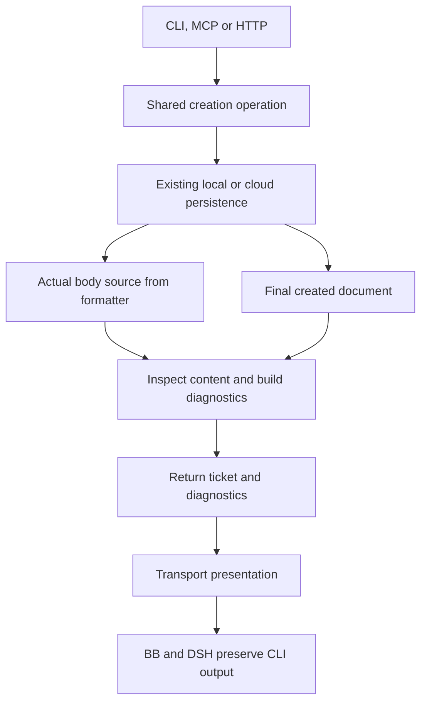

# Architecture: MDT-261

**Status: Approved.** User approved the five consequential decisions and requested completion on 2026-10-26. Implementation and verification remain to be completed.

## Overview and Pattern

Use a shared application operation with transport adapters, plus a pure document policy behind a Git-index adapter. This fits the existing domain-contracts/shared/thin-CLI boundary. Assessment recommends bounded inline redesign: operation metadata and template ownership change inside this ticket; cloud coordination and ticket persistence semantics remain owned by their existing modules.

## Decisions for Review

1. **Add an operation-result API while preserving entity callers.** Keep `TicketService.createCR(...): Promise<Ticket>` compatible and introduce `createCRWithDiagnostics(...): Promise<TicketCreationResult>`. Domain-contracts defines the result and diagnostic schemas; shared constructs the findings and canonical messages. CLI/MCP/HTTP use the new result. HTTP preserves existing success/message/crCode/filename/path fields and adds diagnostics plus the created ticket for consumers to unwrap; neither field is written to frontmatter.
2. **One template catalog with explicit markers and a legacy registry.** Make a compiled shared catalog the authored source for built-in text/metadata; file templates become generated projections checked for drift, and fallback uses the same catalog. New intake prompts carry `<!-- mdt:placeholder:section-id -->`; later-stage sections are omitted or empty. Keep explicit custom file-template loading compatible. Recognition includes current file instructions, old fallback instructions and old generic boilerplate in a versioned legacy registry.
3. **Context-aware deterministic detection.** Use the existing workspace markdown-it parser, declared as a shared dependency, to inspect active prose and HTML marker tokens with line/section context. Fences, inline code, blockquotes and explicitly labelled Example sections are examples. Match known instructions as complete normalized instruction blocks, stripping conservative Markdown emphasis/list wrappers and normalizing whitespace. Do not scan arbitrary words or brackets. Count real prose, technical examples and non-boilerplate criteria as content; a title/headings/comments/generic-scaffold-only document is empty. Legacy implementation deferral is exempt only under Implementation Notes while status is not Implemented.
4. **Offline staged validation through a thin command.** Add `mdt-cli ticket validate --staged [--json|--yaml]`; shared owns config resolution, scope selection, Git snapshot reads and validation. Read index paths/OIDs with NUL-safe Git plumbing, then read complete blobs by object ID. Use staged project configuration, configured ticket paths and code, including epics. Index/config/conflict/parser failures block explicitly. No fallback to live ticket services, registries, working files or network.
5. **Tracked local Lefthook command first.** Register one tracked pre-commit command delegating to a thin local wrapper and the repository CLI. No copied content policy in shell; no auto-install/download in the hook. Missing validator/build capability fails with a build/install remedy. Prove the full merged hook and isolated block/pass commits before considering shared-hook rollout. The separate shared-hooks checkout stays unchanged until that evidence exists.

## Verified Fit and Current Owners

- Existing: shared/services/TicketService.ts owns local/cloud creation and final Markdown generation; TemplateService.ts currently loads files or a divergent fallback. CloudCreateOrchestrator must retain its draft identity, reservation, write and acknowledgement behavior.
- Existing: cli/src/commands/create.ts calls shared and owns presentation; cli/src/output/structured.ts already has diagnostics. Its error envelope uses stderr; success uses stdout.
- Existing: mcp-server/src/tools/handlers/crHandlers.ts owns a duplicate no-content template notice; replace that block with rendering returned diagnostics.
- Existing: server/services/TicketService.ts wraps creation; ProjectController directly forwards that result as HTTP 201. frontend/src/hooks/useTicketOperations.ts and frontend/src/services/dataLayer.ts consume the response and currently assume an entity. Unwrap the additive ticket field and preserve operation diagnostics outside ticket state.
- Existing: plugins/_lib/mdt-tools.js exposes optional content; BB and DSH adapters preserve CLI output. They require propagation proof, not a duplicate notice implementation.
- Existing: domain-contracts owns canonical entity/input schemas. Add operation contracts beside those without changing TicketSchema/frontmatter.
- Existing: lefthook.yml imports remote hooks; lefthook-local.yml carries the ignored CSS gate. PoC on installed 2.1.8 confirms tracked root commands can coexist with a remote script; full effective-config evidence remains required.

## Proposed Structure and Module Boundaries

These are proposed files, not claims of existing modules:

```text
domain-contracts/src/ticket/creation-result.ts   diagnostic and creation-result schemas
shared/templates/catalog.ts                    built-in template source and prompt metadata
shared/templates/legacy-instructions.ts        compatibility phrases and generic boilerplate
shared/services/ticket/content-inspection.ts   pure Markdown policy and finding construction
shared/services/ticket/staged-validation.ts    index snapshot, staged config and document selection
cli/src/commands/validate.ts                    argv to shared request, result to existing formatter
scripts/check-ticket-templates.sh              thin local hook launcher
scripts/generate-ticket-templates.ts           generate/check file projections from catalog
```

Existing files to change deliberately:

- domain-contracts/src/ticket/schema.ts and its barrel: expose operation contracts.
- shared/services/TemplateService.ts: use catalog for built-ins/fallback, retain explicit file override loading; never duplicate authored prompt text.
- shared/services/TicketService.ts: expose operation result and pass actual formatter provenance through operation-local metadata. Existing local/cloud algorithms remain owners of persistence and recovery.
- shared/templates/*.md and templates.json: generated projections; all six types, including Research, use one built-in source. Old phrases move to compatibility recognition, not new prompts.
- shared/package.json: declare the already-used workspace parser dependency; use existing lockfile process for manifest changes. This is a package boundary declaration, not introduction of another Markdown engine.
- cli/src/index.ts, commands/create.ts, output/structured.ts and formatter.ts: register/format; no detection, filtering or project policy here.
- server/services/TicketService.ts: preserve HTTP fields and propagate result metadata; controller retains existing status/auth flow.
- frontend creation consumers: unwrap ticket and surface diagnostics through existing feedback patterns; exact surfaces belong to the UX gate.
- lefthook.yml: tracked command, preserving remote jobs. scripts/AGENTS.md inventory and cli/mdt-cli/SKILL.md document the new entry point.

Runtime policy modules do not import filesystem APIs into browser consumers. The Git adapter imports policy; policy never imports the adapter or transport. Generated file templates do not become a second editable source.

## Canonical Runtime Flows

### Creation



- Normalize absent/empty/blank bodies once in shared before the formatter decides to generate a template. Supplied H1 handling remains authoritative to the title.
- Formatter reports `generated`, `supplied` or recovery without generation to operation-local state. Do not infer generation from whether a transport includes body text. Inspect actual final created/recovered content for unfinished instructions.
- Do not change cloud journal draft fingerprints merely to transport diagnostics; no diagnostic fields enter coordinator payloads, durable identity hashes or ticket frontmatter. A recovered result can report unfinished content without falsely claiming it generated a new template.
- A generated body produces one TICKET_TEMPLATE_UNFILLED summary warning; detailed location findings remain available from the detector for commit reports. Supplied unfinished content produces TICKET_CONTENT_UNFILLED; body-only structural scaffolding produces TICKET_BODY_EMPTY. Central shared message construction tells the caller to replace instructions before committing and keeps creation successful. Deduplicate by code/path/location within an operation.
- The old createCR API discards operation metadata intentionally for compatibility. All supported user-facing creation adapters opt into the new result, while internal legacy entity consumers remain unchanged.

### Staged validation

1. Resolve repository root through Git; preserve any GIT_INDEX_FILE passed by Git commit. Capture index entries and candidate staged additions/modifications/renames; inspect unmerged entries explicitly.
2. Snapshot object IDs for staged configuration and candidate blobs before reading content. Use the snapshot OIDs for reads so concurrent working-file changes cannot affect results. Detect index changes during inspection and fail explicitly rather than combine snapshots.
3. Parse staged `.mdt-config.toml` with existing project config schemas/TOML support. Candidate paths must be direct primary ticket files under the configured ticket directory and code; subdocuments and unchanged files are excluded. Use safe argument arrays and literal/NUL path handling.
4. Reject malformed/conflicting config, unmerged candidate entries, unreadable blobs, unsupported external ticket paths, or inconsistent project/ticket identity with actionable validation errors. A repository with no staged or historically tracked MDT config is not applicable; deleting the tracked config while validating ticket changes cannot silently pass as clean.
5. Inspect full documents through the same detector, elevate findings to errors, and return one structured report. CLI renders existing envelope semantics and exits 1 on findings or validator failure, 0 on a clean/not-applicable result.
6. The hook calls this entry point and propagates failure. It never expands staged filenames into shell code and never fixes/stages files.

## Program Design

Signature-only candidate contracts:

```typescript
interface TicketDiagnostic {
  code: string
  severity: 'warning' | 'error'
  message: string
  ticketKey: string
  filePath: string
  line?: number
  section?: string
  instruction?: string
  correction?: string
}
interface TicketCreationResult {
  ticket: Ticket
  diagnostics: TicketDiagnostic[]
}
createCR(project: Project, type: string, data: TicketData): Promise<Ticket>
createCRWithDiagnostics(project: Project, type: string, data: TicketData): Promise<TicketCreationResult>
inspectTicketContent(document: string, context: TicketContext): TicketDiagnostic[]
validateStagedTickets(request: { repoRoot: string }): Promise<StagedTicketValidationResult>
```

Schemas are authored first in domain-contracts and types inferred; the signatures illustrate boundaries, not separately authored TypeScript shapes. A validation execution error may lack a ticket key; it uses the existing command-error contract with operation context rather than fabricating a TicketDiagnostic for an unknown ticket.

Least-confident decisions and invalidation evidence:

- Template projection compatibility: explicit file overrides and callers of getTemplate must retain metadata/section behavior. Invalidate the catalog migration if characterization tests show relied-on override behavior changing; revise before implementation, rather than silently changing caller semantics.
- Markdown example contexts: enforce explicit syntax and a corpus of active/quoted/fenced/inline examples, nested lists and CRLF. Unclear ordinary prose does not trigger a broad keyword block. If corpus ambiguity cannot be resolved deterministically, return to this decision review.
- Hook composition: probe proves 2.1.8 only. Full actual merged config and real hook executions must retain the validator on the installed supported version. Broader version support and external deployment require separate recorded compatibility evidence.
- Cloud recovery provenance: verify operation metadata remains outside persistence and coordinator identity. If carrying generation metadata changes retry identity, redesign the metadata seam before proceeding.

## Invariants and Constraint Carryover

- C1/C2: one canonical diagnostic contract; shared owns rules/messages; entity and frontmatter unchanged; old entity API supported.
- C3: built-in file/fallback prompts derive from catalog; legacy exact-phrase coverage includes the MDT-233 architecture fixture; future template drift check fails if a projection changes independently.
- C4/C6 and Edge-1: no network/runtime, no writes/index mutation; NUL-safe paths and no shell evaluation; complete immutable staged blobs.
- C5: local proof precedes external shared-hook changes; no new detection in shell.
- Edge-2: legacy deferral exemption uses parsed section and status; does not replace the existing unchecked Implemented-task hook.
- Diagnostic rules detect scaffolding; they never certify prose quality or invent missing requirements.

## Verification and Runtime/Test Separation

- Existing creation baseline: 18 tests green. New compiled-CLI acceptance is red (1 pass, 13 fail), establishing absent diagnostics/command behavior before implementation.
- Runtime catalog/policy modules contain no test fixtures. Compatibility corpus and MDT-233 regression copies live under test-only paths.
- Required downstream proof: schema and legacy API preservation; all transport renderers/native passthrough; catalog/fallback drift; Markdown context corpus; isolated Git index/config/rename/space/deletion cases; actual local Lefthook block/pass and missing-validator failure.
- Executable CLI acceptance exists. Frontend feedback is user-visible, so the UX gate follows architecture approval and must be reviewed before Tests/Tasks. Browser proof exercises the real production DataLayer/HTTP consumer with the board/Toaster mounted. ProjectView.tsx passes showHeader=false, so the legacy Board Create button is not a current routed entry point; no new control is introduced. This evidence cannot be described as a user-click creation journey.

## Migration, Rollout and Rollback

1. Add contracts/operation API and tests with existing callers preserved.
2. Unify template generation/recognition and update creation adapters; verify warnings retain success semantics.
3. Add offline CLI/index validation; prove it in isolated repositories.
4. Wire the tracked local hook and verify the full effective config plus blocked/accepted commits. This completes the local rollout gate only after all required checks pass.
5. Present local evidence and dependency/version contract before touching the separate shared-hooks repository; separately verify another consumer before declaring broader rollout complete.

Rollback: remove the local hook command to stop local enforcement, revert adapters to the legacy createCR result, then revert the template/policy additions as a scoped change. No ticket migration or irreversible persisted metadata needs rollback. Do not remove or rewrite historical tickets.

## Extension Rule and Owner Documents

Add new built-in prompt text only to the catalog; regeneration/check plus compatibility corpus prevents drift. Add a transport by consuming the shared operation result and its diagnostic contract; never copy the rule or message. CI may call the same CLI validator later.

After implementation and verification, reconcile CLI usage, hook setup and template ownership into their existing owner documents. This file describes the proposed ticket design and must not be promoted as current runtime truth before delivery.

## Runtime Prerequisites Reconciled During Verification

The shared build now verifies template projections, so all three Dockerfile base stages copy scripts/generate-ticket-templates.ts and .dockerignore explicitly retains shared/templates/*.md. These are bootstrap-input corrections within the same source/check ownership, with no new runtime service or public API. Full source builds run locally; container images were not built in this verification lane.

The existing Bun DOM test preloader needed synchronous post-registration loading of jest-dom: asynchronous preload evaluation intermittently omitted matchers under --isolate. frontend/src/test-setup.ts preserves DOM-first order, uses createRequire for the side-effect module and installs the existing hook bridge without an incompatible ambient Jest signature. The 26-case preservation group passed three consecutive process runs after the correction.
