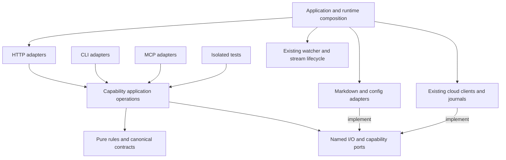

# MDT-266 — Agreed backend module architecture

- Status: agreed design contract, implemented and locally verified on 2026-10-29. The execution result records per-slice evidence and accepted qualifications; current runtime truth belongs to the canonical owner documents.
- Baseline evidence: [module inventory](../module-inventory.md). Delivery: [refactoring plan](refactoring-plan.md) and [execution result](../execution/result.md).
- Canonical owner documents describe current runtime truth and will be reconciled per landed slice. This controlled-refactor run uses ticket-owned execution evidence, without claiming a normal-mode spec-trace pipeline baseline.
- The user subsequently authorized retiring obsolete internal HTTP compatibility paths in [round2](../execution/round2/plan.md). Temporary compatibility allowances below describe the migration contract; current source has independent capability entrypoints and preserves published shared APIs.

## Overview and architecture choice

- Use a layered modular monolith organized by capability, with selective ports and adapters. Module ownership governs rules/state; adapters isolate HTTP/CLI/MCP, filesystem, credential and cloud mechanisms.
- Deployment topology and dependency design are separate axes: the existing local runtimes share application operations; the existing Cloud Worker remains a separate deployment with JSON/HTTPS/WebSocket contracts.
- Use vertical slices to migrate complete operations. Avoid a mandatory domain/application/infrastructure hierarchy for every class, a new package per capability, or new runtime services.
- Primary conceptual references: [Cockburn's original ports/adapters article](https://alistair.cockburn.us/hexagonal-architecture) and [Fowler's Monolith First](https://martinfowler.com/bliki/MonolithFirst.html). Repository evidence, not these pattern names, determines each seam.

## Decisions and module ownership

| ID | Proposed decision | Ownership / rationale |
| --- | --- | --- |
| D-1 | Keep current workspace/package topology | `domain-contracts` owns shapes; shared owns reusable operations/policy and named I/O adapters; server/CLI/MCP own their transport entrypoints. Shared is not mislabeled as pure domain code. |
| D-2 | Separate application construction from runtime activation | One shared Express application factory assembles enabled routes and security; explicit runtime handles own watchers, observations, stream managers, retry runners and process shutdown. |
| D-3 | Make search a shared capability | One owner for ranking, matching, sorting, deduplication and limits; HTTP controllers receive search directly. Preserve HTTP-specific result mapping. |
| D-4 | Extract ticket operations behind the current facade | Ticket queries, mutation preparation and Markdown persistence become cohesive collaborators; reuse existing epic/reference/identity/location policy instead of copying rules. |
| D-5 | Make shared project/config the project-file mutation owner | Evolve existing ProjectConfigService and document patch policy. Server ProjectConfigStorageAdapter delegates after its differing contracts are characterized. Keep global/user scopes distinct initially. |
| D-6 | Keep transport admission separate from reusable rules | HTTP Request/Response, tokens, cookies, origins and preview framing stay in server. Application operations receive validated contracts and resolved context, not Express requests. |
| D-7 | Preserve established realtime and cloud responsibilities | Raw watchers, lazy lifecycle, broadcaster, cloud protocol/recovery and server activation retain their existing owners; bootstrap composes them. |
| D-8 | Enforce boundaries incrementally | A separate module-dependency check rejects forbidden imports; exact legacy edges have a migration owner. The existing decoder/request gate remains a different check. |
| D-9 | Place HTTP adapters inside their capability | Use `server/modules/<capability>/` for controller/router ownership while application operations remain in shared. Existing controller/route paths may remain thin compatibility exports; there is no business logic in those compatibility files. |

## Concrete target map

- Existing paths remain valid compatibility entrypoints during migration. Proposed files are created only in the slice that demonstrates their need.
- Small pin/favorite/trace/read helpers retain their current locations; logical ownership does not require wholesale folder moves.

| Capability | Existing entrypoints retained | Proposed additions / seam | Public operation and exclusions |
| --- | --- | --- | --- |
| Application composition | `server/server.ts`; test factory becomes a thin test wrapper | `server/app.ts`, `server/bootstrap/createRuntime.ts`, `server/bootstrap/types.ts` | Construct app, start runtime, stop/dispose runtime. No import-time listener, heartbeat, subprocess or signal registration in the reusable app factory. |
| Projects/worktrees | `shared/services/ProjectService.ts`, `shared/services/project/*`, WorktreeService, ProjectManager | Narrow injectable project-catalog interfaces at consumers; optional `shared/services/project/index.ts` public barrel | Resolve/list/create/update projects and canonical identities. Consumers do not reach into registries, caches or scan internals. |
| Project config | ProjectConfigService, ProjectDocumentPatch, server ConfigApplicationService and scope adapters | Evolve existing shared project mutation API; server project adapter delegates to it | One owner for project-file candidate validation/merge/persist, including legacy migration. Preserve tolerant display vs strict write contracts; no new parallel writer. |
| Ticket operations | `shared/services/TicketService.ts` compatibility facade | `shared/services/ticket/TicketMutationService.ts`, `TicketQueryService.ts` | Complete commands/queries, with existing resolved project/key semantics; no HTTP status handling or SSE ownership. |
| Ticket persistence | Existing MarkdownService and TicketLocationResolver behavior retained | `shared/services/ticket/TicketRepository.ts`, `MarkdownTicketRepository.ts` | Ticket-specific snapshot/read/write contract; preserve YAML/content, path safety and worktree resolution. No generic repository framework. |
| Ticket rules | Existing `epicRules.ts`, `ticket/{derivedFields,referenceMutations,TicketIdentityService}.ts` | Reuse/extract pure policy where it has one invariant owner | Validate complete requested state; no credentials, HTTP clients, timers or watcher subscriptions in pure policy. |
| Search | Server TicketService search methods and SearchController remain adapters during transition | `shared/services/search/SearchService.ts` | Search projects/tickets via catalog/query operations; preserve external refs, matchedBy, ranking, ordering and limits. No document-content search feature added. |
| HTTP project/ticket adapters | `server/routes/projects.ts`, ProjectController, server TicketService facade as compatibility delegates where required | `server/modules/tickets/{TicketController,routes,index}.ts`, `server/modules/projects/{ProjectController,routes,index}.ts`; `server/http/projectAccess.ts` | Capability-owned HTTP adapters; project and ticket operations have distinct owners. Document routes use project-access middleware, not another controller. |
| Other capability HTTP adapters | Existing search/document/config/access/realtime/system routes/controllers remain compatible | `server/modules/<capability>/` owns each migrated adapter through a small public entrypoint | Group working adapters by their actual capability; do not copy rules into them or create a separate deployment per folder. |
| Documents/tree/preview | DocumentService, TreeService, ConfigRepository, commands, invokers, strategies, DocumentController | Inject existing catalog/config/file readers as relevant slices touch them | Document eligibility/tree/content operations. Preview HMAC/CSP/streaming stay at existing HTTP/security seams. |
| Favorites, pins and trace | DocumentFavStateService, PinStateService, TraceStoreService and shared SubdocumentService | None required initially | Distinct state scopes and eligibility; trace remains read-only over resolved ticket locations. |
| HTTP security/sharing | `server/security/*`, auth/share/read-token/document routes | Inject resolved project-access policy; preserve existing security APIs initially | Admission/session/preview rules and project visibility. Cloud membership and credential policy remain separate. |
| Realtime | `server/services/fileWatcher/*`, `server/routes/sse.ts` | Existing facade public API; lifecycle ownership composed in runtime | Watch subscriptions, normalized file events, cache invalidation, broadcaster and teardown. Rules do not import broadcaster internals. |
| Cloud operations | `shared/services/cloud-sync/*` including create orchestrator, recovery, clients and read model | Narrow operation/credential ports already present; introduce a named adapter only if extraction needs it | Allocation, journals, explicit recovery, projection protocol. No Worker implementation imports or browser credentials. |
| Cloud process activation | ProjectionStreamManager, TicketIdentityObservation | Move only assembly/start/stop from server.ts into createRuntime | Process-scoped broker, one stream per enabled project, bounded retries and observation. Preserve rollout flag and background non-interactivity. |
| Operational HTTP adapters | `server/routes/system.ts`, devtools/docs routes, middleware | Extract affected filesystem/config operations behind named service calls when migrated | Keep current endpoint formats and deployment flags; error-envelope redesign belongs to MDT-111. |

## Dependency rules

| Source | Allowed dependency | Forbidden dependency |
| --- | --- | --- |
| domain-contracts | Schemas, canonical types, pure contract helpers | Node filesystem/path policy, shared/server services, transports |
| Shared application operations | Canonical contracts, own policy, injected capability interfaces and I/O ports | Express, server controllers/routes, CLI/MCP rendering |
| Pure ticket policy | Contract types and existing pure rule helpers | File I/O, cloud clients/credentials, watchers, HTTP objects |
| I/O adapters | Their port/contract and concrete technology | Calling back into HTTP controllers or unrelated capability internals |
| Search | Project catalog and ticket query public operations | Ticket mutation internals, direct directory scans, controller getters |
| Project-config HTTP adapter | Shared project mutation/read API and selector policy | A second independent project-file read/modify/write implementation |
| Controller | Application operations and transport admission/response mapping | Another controller as a service locator |
| Realtime/cloud runtime | Existing component public lifecycle and injected callbacks | Ticket policy owning client/timer lifecycle; public GET initiating creation repair |
| Composition roots/facades | Concrete modules needed to assemble dependency graphs | Business decisions newly added to bootstrap |

- Configuration scope is supplied as immutable request context to async operations/effects; a router-wide mutable current-project variable is not part of the target design.
- The existing shared TicketService facade may assemble concrete collaborators for backward-compatible construction; new application operations accept their dependencies. Keep that exception explicit rather than requiring a DI container.
- Capability boundaries are logical within existing packages. Private/internal import restrictions are tightened only after callers have a usable public seam.
- Final HTTP grouping includes tickets, projects, search, documents, config, access, realtime and system as applicable to existing routes. Implementers choose concise filenames; test/build coverage must include the new `server/modules/` and bootstrap paths.

## Critical flows and program design

### Application construction and lifecycle

1. Each entrypoint resolves its configuration/dependencies explicitly.
2. `createApplication` mounts the same enabled public/auth/protected route graph with injected services; it does not activate background work.
3. Production bootstrap owns listen/startup initialization. Isolated tests use the same application factory with fixture dependencies and explicit runtime options.
4. Runtime activation owns registry registration/watchers, identity observation, heartbeat, projection streams, credential re-arm and journal retry runners.
5. Idempotent disposal stops only owned timers/listeners/streams/watchers; process signal handlers exist only in the executable entrypoint.
6. Disabled stream rollout still supplies the appropriate route/provider contract with local-only behavior; tests do not omit feature routes to avoid networking.

```ts
declare function createApplication(options: ApplicationOptions): ApplicationHandle
declare function createRuntime(options: RuntimeOptions): RuntimeHandle

interface RuntimeHandle {
  start(): Promise<void>
  stop(): Promise<void>
}
```

- These are proposed signature-only internal contracts. Existing transport DTOs are imported/derived; new canonical data shapes are not redeclared here.

### Complete ticket mutation

1. Transport parses its existing request contract and performs existing admission checks.
2. Application resolves project identity and the unambiguous physical ticket location through the existing shared resolver.
3. Read the current snapshot; prepare and validate the entire requested mutation, including epic/reference/derived-field constraints, before a canonical write or publication.
4. Persist the prepared local ticket through the ticket persistence owner; do not implement status and remaining attributes as separate transport-owned commands.
5. Invoke the existing projection journal/publishing workflow after local success, preserving its documented retry and recovery outcomes.
6. Rejected domain validation leaves bytes and publication attempts unchanged. Failure after a successful local write follows the existing explicit partial-failure/recovery contract.

- This corrects the demonstrated defect. It is deliberately separate from subsequent preservation refactoring.
- Atomic file replacement does not establish serializable read/modify/write across processes or external editors. Establish snapshot/conflict/lock scope before claiming concurrent-update safety; do not promise a transaction spanning local files and cloud.

### Search

1. HTTP/CLI/MCP-specific adapter maps its supported request to shared search/query operations.
2. Search consumes eligible project/ticket read operations, applies the existing algorithms, deduplicates and limits in the characterized order.
3. Each transport maps results to its existing response contract. Preserve current error behavior unless a separate correction is specified.
4. The server's canonical/projected unified ticket read remains a presentation read-model composition, not another ticket authority.

### Project configuration

1. HTTP selector admission and guarded-operation policy remain in ConfigApplicationService; runtime effects receive immutable per-operation project context.
2. Project-scope adapters call the shared project/config mutation owner. CLI/MCP/project operations use the same owner through existing facades.
3. That owner preserves strict write reloads, tolerant display reads, legacy migration behavior, sibling fields, missing-file behavior and per-operation obsolete-section handling.
4. Return saved effective values before/alongside the existing explicit effect report; watcher/cache effects do not become hidden filesystem-helper side effects.
5. Registry and local project config remain separately persisted files; multi-file recovery and concurrency guarantees are not invented by this delegation.

### External edits and cloud observation

- External file change -> existing PathWatcherService -> facade metadata/cache processing -> existing SSEBroadcaster -> scoped SSE transport -> browser resync behavior.
- Cloud activation -> process-scoped broker/session/stream clients -> existing read model -> normal local event/read boundary. Background observation never logs in interactively or resumes retained creation.

## Diagram



- Arrows show code dependencies/composition, not a new cross-module event bus.

## Preserved invariants and extension rule

- Canonical ticket content remains Markdown/Git; cloud projections, identity caches, local journals, pins and favorites retain their documented authority and lifetime.
- HTTP/CLI/MCP public inputs, response/error formats, filenames, configuration keys, legacy reads and imports remain compatible except the explicitly tested corrective behavior.
- Ticket routing preserves worktree identity, ambiguity rejection, namespaces and subdocuments; document roots do not silently follow ticket worktrees.
- Auth ordering, scoped read/SSE visibility, preview token/CSP/sandbox gates, credential non-disclosure and background non-interactivity remain intact.
- Lazy watchers, registry exception, subscription teardown, one stream per project and rollout gating retain their existing owners and behavior.
- A new feature starts at its capability's public operation. Add an adapter/port only for a demonstrated external mechanism, substitution need or lifecycle boundary; do not duplicate the operation for each transport.

## Least-confident decisions and review conditions

These were preparation-stage questions and gates. Their experiments, resolutions and retained limits are recorded in the [execution result](../execution/result.md).

| Question | Current evidence / proposal | What must settle it |
| --- | --- | --- |
| Concurrent ticket/config updates | Independent processes/editors can write the same canonical file; atomic replacement alone is insufficient | Inventory write ownership and run competing-update/alias probes; specify narrower guarantees or a separately reviewed conflict/locking design |
| Config request context race | Router-wide mutable resolver/project variables span awaited persistence/effects | Deterministic paused-write overlapping-request test; if reproduced, independent corrective slice before preservation |
| Exact ticket repository API | Current service mixes rendering, identity and writes | Characterize representative create/patch/read operations; use a ticket-specific port without copying the full facade into a new interface |
| Project-config delegation | Server/shared contracts differ around creation, display strictness, migration and sync callers | Compatibility matrix and tests before adapter redirection; preserve per-entrypoint behavior through named operations |
| Production cloud/runtime parity | Current E2E app lacks some real wiring; deployed rollout remains gated | Common-factory tests with isolated cloud dependencies, lifecycle tests, and separately authorized deployed gates |

- Astra preparation alignment: @thread:thr_8pe53d2pib; agreed on D-1 through D-8 and the config/concurrency qualifications. The user subsequently agreed to capability-owned controllers and authorized implementation (D-9); final patch review remains independent of executed verification.
